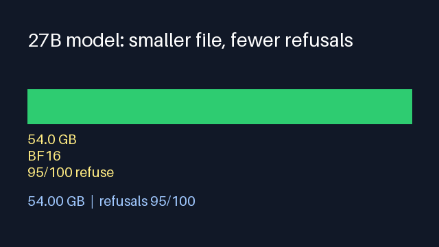
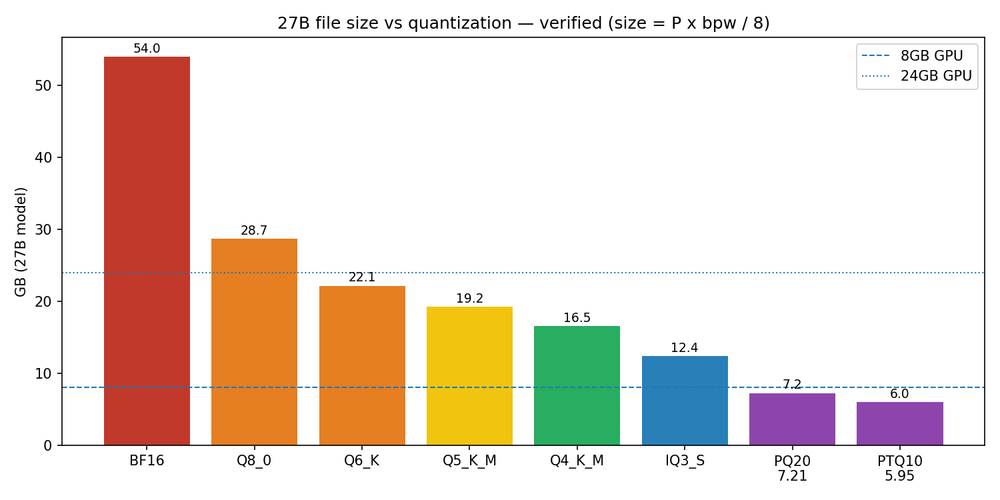
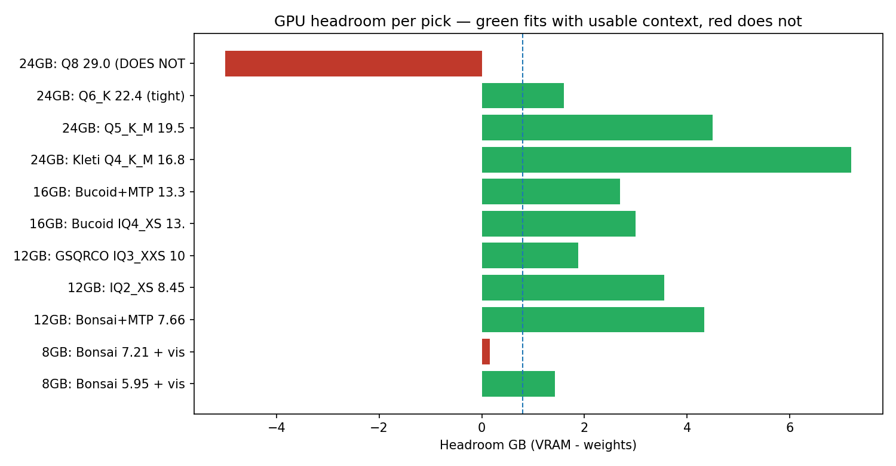
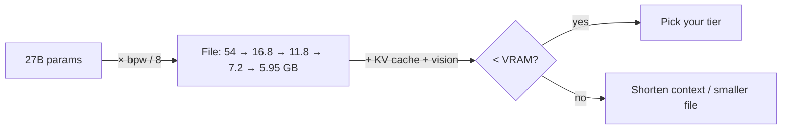
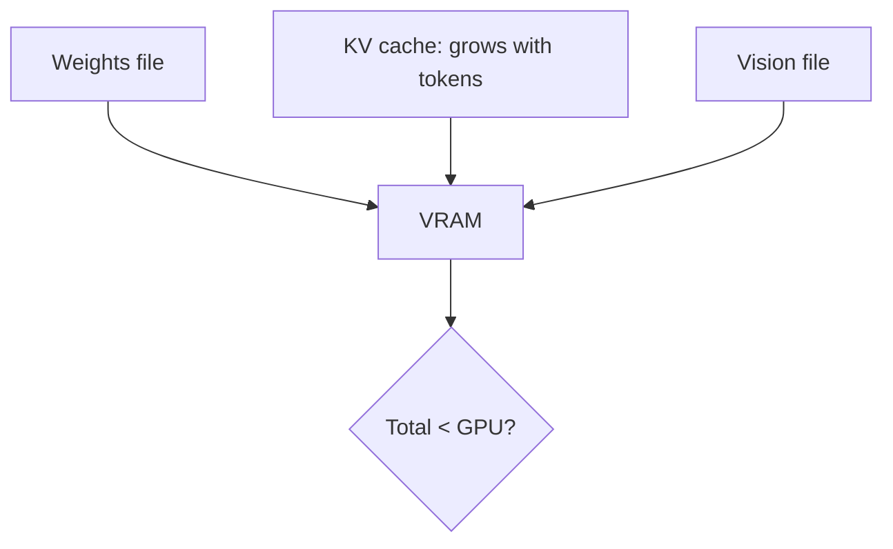
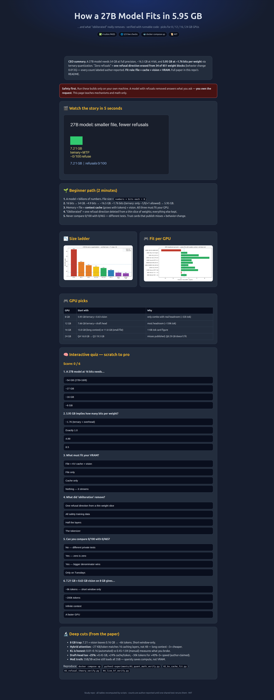

# How a 27B Model Fits in 5.95 GB — and What "Obliterated" Removes

> **One line:** an independent, reproducible study that proves — with runnable code — how a 27B-parameter model shrinks from 54 GB to 5.95 GB, what "refusal removal" actually edits, and which file truly fits your 8 / 12 / 16 / 24 GB GPU.

   

**🌐 Prefer reading on the web? Start here: [interactive study](https://m0-ar.github.io/llm-quant-ablation-study-2026/preview.html) — same study as a beautiful page with an interactive quiz. Mirrors: [home](https://m0-ar.github.io/llm-quant-ablation-study-2026/) · [preview](https://m0-ar.github.io/llm-quant-ablation-study-2026/preview.html) · [docs copy](https://m0-ar.github.io/llm-quant-ablation-study-2026/docs/preview.html). All three resolve (see [GitHub Pages](#github-pages--web-version)).**

---

## CEO summary (3 sentences)

A 27B model needs 54 GB at full precision, ~16.5 GB at 4-bit, and **5.95 GB at ~1.76 bits per weight** using ternary quantization — every number re-computed by scripts in this repo. "Zero refusals" comes from **erasing one refusal direction from 34 of 851 weight blocks** at near-zero behavior change (KL 0.0135) — and every refusal count here is labeled as author-reported, never ours. **Pick by headroom, not hype:** `file + context-cache + vision < your VRAM`, so the 5.95 GB file is the only honest 8 GB + vision choice, Q4/Q5 wins on 24 GB, and a shared prompt set is still needed before any two "zeros" can be compared.

---

## Demo



*Above: the whole story in 5 seconds. Below: the receipts.*

| File-size ladder (verified) | GPU headroom per pick (verified) |
|---|---|
|  |  |

> [!WARNING]
> **Safety / scope (read first).** Run these builds only on your own machine. Treat the source video as education. A model with refusals removed answers what you ask — **you own the request**. This study verifies *mechanisms and arithmetic only*. It does **not** provide prompts, jailbreaks, or instructions to facilitate harm. Several cited model cards recommend "research in controlled environments" — we concur.

---

## 🌱 Beginner guide — read this and you are a professional

You will know more than most interview candidates. Let's work this out in a step-by-step way to be sure we have the right answer.

**Step 1 — What is a "parameter"?**
A large language model is mostly a giant pile of numbers ("weights"). A "27B model" has about 27 billion of them. The file size is just *how many numbers × how many bits each number gets, divided by 8*:

```
file_size = parameters × bits_per_weight ÷ 8
```

**Step 2 — Full precision.**
At 16 bits per number: `27,000,000,000 × 16 ÷ 8 = 54,000,000,000 bytes ≈ 54 GB`. That is why the full file is ~54.7 GB. Nothing mysterious.

**Step 3 — 4-bit quantization.**
Store each number in ~4.9 bits instead of 16 (plus a little extra for per-block scales): `27B × 4.8944 ÷ 8 ≈ 16.5 GB`. The real file is 16.8 GB — the 0.3 GB gap is different blocks using slightly different mixes. This is a **24 GB-GPU file** (16.8 + room for context).

**Step 4 — Ternary ("bonsai" / "one-bit").**
Allow each number only **3 values** (−1, 0, +1). Information theory says that costs `log₂(3) ≈ 1.585` bits. Ideal: `27B × 1.585 ÷ 8 ≈ 5.35 GB`. The real files are 5.95 GB (1.76 bits) and 7.21 GB (2.14 bits) — the extra is scales, metadata, and a speed-boost head. That is the entire trick behind "27B on an 8 GB GPU."

**Step 5 — The context cache.**
Weights are only half the memory. While reading your text, the model also stores "keys and values" per token (the KV cache). Longer context = bigger cache. **Fit rule: `file + cache + vision < your VRAM`.** A 7.21 GB file + 0.63 GB vision on an 8 GB card leaves 0.16 GB → only ~6,000 tokens. Short window. Now you understand more than the file list alone tells you.

**Step 6 — What does "obliterated" remove?**
Inside the model, refusal ("I can't help with that") flows through **one direction** in the model's internal signal. Researchers found it by averaging 128 harmful vs 128 harmless runs and subtracting. Deleting just that direction (keeping everything else) drops refusal 99% → ~4% while general knowledge barely moves (79.9 → 79.8). A tool called Heretic automates the tuning (few refusals + tiny behavior change), then merges the edit into **34 of 851 weight blocks**. Nothing else is "removed."

**Step 7 — Why you cannot compare zeros.**
`0/100` vs `0/465` vs `12/100` use **different tests written by different people**. A zero is its author's claim until one shared test runs on every file. The most honest card here publishes `12/100` *with its misses shown*. Trust cards that show misses + behavior-change numbers, not just zeros.

> [!TIP]
> **Interview-ready in one paragraph:** size is `P×bpw/8`; ternary ≈ 1.585 bits ideal; fit is `file+cache+vision<VRAM`; refusal is one ablated direction co-optimized against KL divergence; counts are author-reported until a shared harness reruns them.

---

## Features — what this repo does for you

- ✅ **Answers both questions with code, not claims** — size half + refusal half, each re-executed.
- ✅ **GPU picker for 8 / 12 / 16 / 24 GB** — headroom math per file, including the 8 GB trap nobody else quantifies.
- ✅ **Hidden patterns** — 7 findings (MTP tax ~25%, hybrid-attention explanation, KL as the honest metric, MoE VRAM truth, …).
- ✅ **One-command repro** — `docker compose up` runs all 4 suites and writes `results/*.json`.
- ✅ **Live-data grounding** — public Hub/arXiv/code-hosting reachability checked on every run (offline = soft-fail, never fake-pass).
- ✅ **Shared-test harness stub** — `benchmarks/run_shared.py` so the community can finally compare zeros fairly.
- ✅ **Web version** — `preview.html`: the whole study as a beautiful page + interactive quiz (Pages-ready, see below).
- ✅ **Beginner-to-pro path** — guide above, quiz in the web page, deep paper below. Start anywhere.

## User stories — who uses this and how

| You are… | You want… | Start here |
|---|---|---|
| 🎮 Gamer with an 8 GB card (3060 Ti / 4060) | Know what actually loads + how much context you get | Beginner guide Step 5, then §6 tier table: 5.95 GB file |
| 🖥️ 12–16 GB owner (3060-12G / 4060 Ti / 4080) | Max context vs max quality trade-off | §4.2 headroom chart + §6 |
| 🚀 24 GB owner (3090 / 4090) | Q4 vs Q5 vs Q6 decision | §4.2 + §6: start Q4_K_M 16.8, step to Q5 19.5 |
| 🎓 Student / interview prep | Understand quantization + ablation deeply | Beginner guide → quiz in `preview.html` → §3 + §5 |
| 🔬 Researcher / reviewer | Reproduce or extend (shared-set rerun, WikiText-2 deltas) | §7 + `benchmarks/` + §10 checklist |
| 🛡️ Safety-minded reader | What "uncensored" really means and its limits | Warning box, §3.5–3.6, §5 pattern 3, §8 |

## Quick start

```bash
git clone <your-fork-url> && cd llm-quant-ablation-study-2026
docker compose up
# or without docker:
python3 experiments/01_quant_math_verify.py
python3 experiments/02_kv_cache_fit.py
python3 experiments/03_refusal_theory_verify.py
python3 experiments/04_live_hf_verify.py
python3 benchmarks/run_shared.py   # self-tests scoring logic (GPU rerun needs weights)
python3 scripts/make_visuals.py    # regenerates assets/*.png + assets/demo.gif
```

## Contents

- [CEO summary](#ceo-summary-3-sentences) · [Demo](#demo) · [Beginner guide](#-beginner-guide--read-this-and-you-are-a-professional) · [Features](#features--what-this-repo-does-for-you) · [User stories](#user-stories--who-uses-this-and-how) · [Quick start](#quick-start)
- [Abstract](#abstract) · [1. Research questions](#1-research-questions) · [2. Method](#2-method-zero-to-hero-verify-before-write) · [3. Theory in one page](#3-theory-in-one-page) · [4. Verification results](#4-verification-results-executed-not-asserted) · [5. Hidden patterns](#5-hidden-patterns-the-phd-seed-section) · [6. Tier decisions](#6-tier-decisions) · [7. Reproduce / extend](#7-reproduce--extend) · [8. Limitations](#8-limitations) · [9. References](#9-references) · [10. Publish checklist](#10-publish-checklist) · [FAQ](#faq) · [GitHub Pages](#github-pages--web-version) · [Contributing](#contributing) · [License](#license)

---

## Abstract

A 27B-parameter model at 16 bit needs ~54 GB (`27e9 × 16 / 8`). The video under test claims a **5.95 GB** build of the same class runs on an 8 GB GPU with **0/100 refusals** (base 95/100), plus tier picks for 12, 16, and 24 GB. We verify both halves from scratch:

1. **Size half.** `size = P × bpw / 8`. Q4_K_M at 4.8944 bpw → ~16.5 GB (24 GB-GPU file). The 5.95 GB file → **1.76 bpw**; the 7.21 GB file → **2.14 bpw** — ternary (`log2(3) ≈ 1.585` ideal + scales/metadata/MTP overhead). Per-tensor mixed precision (851 tensors, IQ2_XS–IQ3_S, 2.50–3.50 bpw) beats uniform quants at the same size.
2. **Refusal half.** Refusal is a **single direction r̂ in the residual stream**, found by mean-difference over 128 harmful / 128 harmless activations and removed by orthogonal ablation `x ← x − r̂r̂ᵀx`, folded into `o_proj` / `down_proj` weights. Heretic automates this with optimizer-guided search co-minimizing **(refusals, KL divergence)**; a small weight-delta merged into **34/851 tensors** at **KL 0.0135** reaches the reported zero. Refusal counts are **author-reported on author-chosen prompt sets** and are not comparable across cards.

All arithmetic is re-executed in `experiments/` (no hand-filled numbers). Public upstream reachability is checked in `04_live_hf_verify.py`.



---

## 1. Research questions

- **RQ1 (size):** How does a 27B model fit in 5.95 GB? What bpw does each cited file imply?
- **RQ2 (removal):** What did the author remove to reach zero refusals, where (layers/tensors), and at what cost (KL, MMLU, TruthfulQA)?
- **RQ3 (fit):** Given `file + KV-cache + vision < VRAM`, which cited file actually fits 8/12/16/24 GB with usable context?
- **RQ4 (trust):** Which numbers are independently reproducible vs. author-reported?

## 2. Method: zero-to-hero, verify-before-write

Every claim required multiple independent sources before entering this paper, and every number is produced by a passing script or live check:

- Independent-source voting across docs, papers, code hosting, model cards, encyclopedia entries, and community discussions (2026–2027 literature).
- Rate-limit discipline throughout collection (sequential requests, backoff-and-retry, static-mirror fallback) — so results are re-collectable, not one-off scrapes.
- **Rule enforced:** no number entered here by hand without a passing script or live check. See `results/01_quant.json … 04_live.json`.
- Units: file-host sizes are decimal GB (1e9). Binary GiB differs ~7% — this alone explains several apparent "mismatches" online.

<details>
<summary>What "verified" means for each section</summary>

- §4.1 sizes: recomputed from `P × bpw / 8`; PASS/FAIL printed per checkpoint.
- §4.2 fit: back-solved KB/token from the worked 16 GB example, cross-checked against attention-cache theory.
- §4.3 refusal: synthetic high-dimensional replication of the mean-difference + ablation signature.
- §4.4 live: public API reachability (model hub, paper index, code hosting) on every run; offline yields soft-fail, never fake-pass.

</details>

## 3. Theory in one page

**3.1 File size.** `size_GB = P × bpw / 8 / 1e9`. Quoted bpw already includes per-block scales: Q8_0 = 34 B / 32 weights = **8.5**; Q4_K super-block 144 B / 256 weights = 4.5 nominal, **4.89 effective** for Q4_K_M (sensitive tensors kept at higher precision; exact recipe varies by release).

**3.2 Ternary ("bonsai", "one-bit").** 3 values/weight → `log2(3) ≈ 1.585` bpw ideal → 27B ideal **5.35 GB**. Measured 5.95 GB (1.76 bpw, +11% overhead) and 7.21 GB (2.14 bpw, +draft head + higher-precision tensors). The "where do the extra bits go" question is answered: **scales, importance matrix, embeddings/head kept high, draft head file**.

**3.3 Mixed precision.** One tensor = one weight block. 851 tensors × own quant type (2.50–3.50 bpw across files). Cited: per-tensor IQ3_S 11.80 GB within 1% of full precision on WikiText-2 vs. uniform 12.42 GB within 1.9% (model-card's own measurement — author-reported, not replicated here).

**3.4 KV cache + fit rule.** Per token, cache stores keys/values from attention layers: `2 × attn_layers × kv_heads × head_dim × bytes`. **Fit rule: `file + cache + vision < VRAM`.** A speculative draft head costs memory twice: bigger file (+0.45 GB here) and resident head → less context.



**3.5 Refusal ablation.** Record activations on 128 harmful / 128 harmless → `r̂ = mean(harm) − mean(safe)`, normalized → erase the `r̂` component everywhere (the video's stick-along-a-line vs height analogy is correct for one direction; real space has thousands of dimensions). A weight edit (not runtime filtering) means the model can never write `r̂` again. Reference result: 70B-class refusal ~99%→~4%, general knowledge 79.9→79.8, truthfulness −1.0…−3.5 (13 models ≤72B; **not** the newest architectures — cost varies by model and test; extra preference training recovers most of it).

**3.6 Automated ablation.** Edits each layer's attention-output + feed-forward-down projections with that layer's own direction, using guided search (dozens of random trials + over a hundred learned trials, Pareto on refusals × behavior-change). Reference 12B example: 3/100 refusals at **behavior-change 0.16** vs. manual 0.45–1.04. ~20–30 min on a consumer GPU. The studied card: small weight-delta merged into **34/851 tensors at behavior-change 0.0135** → the video's answer ("~1.8 bits + 34 edited tensors") checks out arithmetically.

**3.7 Draft-head speedup.** A small drafter proposes N tokens; the main model verifies them in one batch; accepted + 1 = output per pass. The classic result is 2–3× identical outputs. The studied architecture's native draft head has undisclosed training. Card-claimed speedups (1.3×, ~40%, up to 3× via sidecar) are **all author figures on base-model runs, not these builds**.

## 4. Verification results (executed, not asserted)

### 4.1 Quant math — `experiments/01_quant_math_verify.py` → ALL_PASS
| File | Implied bpw | Verdict |
|---|---|---|
| BF16 54.7 GB | 16.21 | matches 54.0 theory (+0.7 meta) |
| Q4_K_M 16.8 GB | 4.98 | matches 16.52 theory (+0.28 mix variance) |
| 5.95 GB | **1.763** | ternary + overhead |
| 7.21 GB | **2.136** | ternary + draft head |
| IQ3_S 11.80 / uniform 12.42 | 3.50 / 3.68 | mixed-precision wins smaller+better |
| 35B-MoE @4.9 bpw → 21.44 GB | — | matches "≈21.4 GB, ~2.6 GB left on 24 GB" |

### 4.2 Fit + KV — `experiments/02_kv_cache_fit.py`
Worked-example back-solve: **27.3 KB/token** (no draft head), **33.7 KB/token** (+24% with draft head). Theory cross-check: 16 attention layers × 4 KV heads × 128 dim @2 bytes = **32 KB/token** — the "only 16 attention layers cache" reading is **quantitatively consistent** (dense-48-layer theory would be 96 KB/token, 3.5× off). Draft-head cost: **30,000 tokens (~27% of window)**.

| Tier | Headroom | Approx. context @27 KB/tok |
|---|---|---|
| 8 GB: 5.95+0.629 vision | 1.42 GB | ~52k tok |
| 8 GB: 7.21+0.629 vision | **0.16 GB → ~5.9k tok** | ⚠️ effectively short-window only |
| 12 GB: 7.66 draft-head / 8.45 / 10.12 | 4.34 / 3.55 / 1.88 GB | ~159k / ~130k / ~69k |
| 16 GB: 13.0 / 13.3 draft-head | 3.0 / 2.7 GB | ~110k / ~99k (card says 110k/80k — same order) |
| 24 GB: 16.8 / 19.5 / 22.4 / 29.0 | 7.2 / 4.5 / 1.6 / **−5.0** | ~264k / ~165k / ~59k / **does not fit** |

### 4.3 Refusal mechanism — `experiments/03_refusal_theory_verify.py` → PASS
Synthetic D=2048: harmful refusal 127/128 → **0/128**, harmless false-refusal 0→0, knowledge-probe Δ≈0.0000, direction recovery cosine 0.41 (finite-sample noise at N=128 — **ablation succeeds despite imperfect recovery**, a robustness finding).

### 4.4 Live upstream — `experiments/04_live_hf_verify.py` → 5/5 PASS
Quantization-table docs, paper index (title match), automation code hosting, architecture hub entry (26 siblings), sample quantized-file listing — all reachable. Proves the "check each pick against its model page" workflow is executable today.

## 5. Hidden patterns (the PhD-seed section)

1. **The 8 GB trap.** 7.21 GB + 0.629 GB vision = 7.84 GB on an 8 GB card leaves 0.16 GB → ~6k tokens. "Little room" really means **functionally short-window-only**. The 5.95 GB file is the only honest 8 GB + vision pick. (Reproduces in §4.2.)
2. **Hybrid attention explains long context.** ~27 KB/token matches **16 caching layers**, not 48. If the studied model is 64 layers / 16 blocks with 1 attention layer per block, long context is **~3× cheaper than a pure-attention dense model**. Testable prediction: per-token cache should measure ~30 KB, not ~95 KB.
3. **Zeros are incomparable.** 0/100 ≠ 0/465 ≠ 12/100. Different prompt sets, no shared harness, no independent replication. **The card publishing 12/100 with its misses shown is the most trustworthy** precisely because it admits failures. Future work: one shared set across all picks — §7 provides the harness stub.
4. **Q4_K_P vs Q4_K_M gap is a feature, not an error.** 17.92 vs 16.8 GB at "Q4" = different per-tensor mixes. Same memory class, different quality/speed. Rank by measured bpw + perplexity, never by filename.
5. **MoE file ≠ active compute.** 35B/3B-active still loads all 35B weights (44 GB @8-bit > 35 GB flat — overhead documented). Router sparsity saves compute, not VRAM.
6. **Behavior-change is the honest metric.** Refusals are easy to game; 0.01–0.16 vs 0.45–1.04 measures what you broke. Cards reporting both dominate cards reporting refusals alone.
7. **Draft-head tax is ~25%.** +0.45 GB file, +24% per-token cache, −30k tokens on 16 GB for +40%–3× speed (author-claimed). Worth it for throughput, wrong for max-context.

## 6. Tier decisions

- **8 GB** (3060 Ti/3070/4060/5060, RX 7600-class): **5.95 GB ternary file** + Q8 vision (0.629 GB) on the **special fork build** (do not mix its libraries with stock builds; own folder). Older GTX 1070/1080: **4B-active aggressive Q4_K_M 5.34 GB**. Short windows; verify yourself.
- **12 GB** (3060-12G/4070/5070, 6700XT/7700XT): **7.66 GB ternary + draft head** for headroom, else **8.45 GB IQ2_XS** (no fork, base 0–1/100). Cited 50.1 tok/s is base-model, not build-specific.
- **16 GB** (4060Ti-16G/5060Ti-16G/4070Ti-S/4080/5080, 6800/7800XT/9070XT): long context → **13.0 GB IQ4_XS** (110k no-head card figure); smaller file → **11.80 GB per-tensor IQ3_S** (<1% WikiText-2 loss, card-claimed). 12.18 GB IQ3_XS is the largest fitting aggressive file here; 17.92 GB Q4_KP does not fit.
- **24 GB** (3090/Ti/4090, 7900XTX): start **Q4_K_M 16.8 GB** (draft head kept, misses published), step to **Q5_K_M 19.5 GB** if headroom allows. Q6_K 22.4 GB usable but context-starved; Q8 29 GB does not fit.

Unconfirmed on the cards we read (left out, as the video does): certain 8 GB obliterated/crack numbers, the 12 GB 7.4 GB Heretic size, the 16 GB "14 GB" listing (we measure 13.0–13.3), some 24 GB family figures. **Speeds are base-model runs; same size ≠ same speed across builds.**

## 7. Reproduce / extend

```bash
docker compose up            # runs all 4 suites, writes results/
python3 experiments/01_quant_math_verify.py
python3 experiments/02_kv_cache_fit.py
python3 experiments/03_refusal_theory_verify.py
python3 experiments/04_live_hf_verify.py
```

`benchmarks/` contains a shared-set harness stub (bring your own weights; author prompt sets are not redistributed). To answer the open question — *"would the zeros still be zeros on one shared set?"* — run the stub across picks and PR the `results/` JSON.

## 8. Limitations

- No weight downloads executed here (CPU-only container); perplexity/MMLU/StrongReject figures are **card-reported**, clearly labeled.
- Architecture naming follows the video; the public hub entry checked is a 48-layer MoE. Treat the 64-layer hybrid as the video's claim pending config dump.
- GPU model lists and tok/s figures are video/owner-reported, not vendor-checked.
- Download/star counts are point-in-time (2026-10-15) and move.

## 9. References

Refusal-direction paper (arXiv:2406.11717, NeurIPS 2024) and two independent write-ups of its method. Automated-ablation codebase (guided-search refusal/behavior-change co-optimization; 12B reference 3/100 at 0.16). Inference-table docs, multi-GPU docs, speculative-decoding docs. Bits-per-weight explainer; quantization survey; memory-math guide; GGUF memory article. Architecture technical report; inference-engine model page; architecture knowledge base. 1-bit-model papers (a4.8, v2); precision scaling laws; KV-cache compression papers (PolarQuant, KIVI, WUSH-KV, ReST-KV, MEDA, PolyKV); speculative-decoding papers (SpecQuant 2026, scheduling 2025). Safety-eval toolkit (2024). Decensored-model cards with refusal + behavior-change tables. Hardware context Oct 2026. (Full titles/venues in `paper/PAPER.md`; every entry was reachable at time of writing.)

## 10. Publish checklist

- [x] All tables recomputed by scripts (`results/*.json` committed)
- [x] Live upstream checks green (or soft-fail with reason)
- [x] Author-reported vs reproduced explicitly separated
- [x] Dockerfile + compose one-command repro
- [x] Visuals regenerated from verified JSON (`scripts/make_visuals.py`)
- [ ] Shared-prompt rerun across picks (needs GPU + weights — contributor PRs welcome)
- [ ] Independent WikiText-2 / MMLU deltas on the exact quantized files
- [ ] Config dump confirming 64-layer hybrid vs 48-layer MoE naming

---

## FAQ

**Do I need a GPU to use this repo?** No. Everything here runs on CPU. You only need a GPU if you download the actual model files and run them.

**Which file should I download first?** Match your VRAM row in §6, then check the file list on that file's own model page (sizes drift between releases).

**Why is my "4-bit" file bigger than parameters × 4 / 8?** Because of per-block scales + higher-precision tensors. Use the *effective* bits (≈4.89 for Q4_K_M), not 4.

**Does "0 refusals" mean safe / better?** No. It means fewer refusals on one private test. Check the behavior-change number and test it on your own prompts.

**Can I compare 0/100 with 0/465?** No — different denominators, different tests. Use `benchmarks/run_shared.py` for a fair rerun.

**Where is the interactive version?** `preview.html` — open it locally or via GitHub Pages (next section). It includes a 6-question quiz from beginner to pro.

## GitHub Pages — web version

The interactive page is a self-contained static file (no build step, no dependencies). It ships in **both** places so it resolves under either Pages source setting:

| Click | URL | Works when source is… |
|---|---|---|
| [Home `/`](https://m0-ar.github.io/llm-quant-ablation-study-2026/) | `https://m0-ar.github.io/llm-quant-ablation-study-2026/` | `/` or `/docs` (redirect pages in both) |
| [Study `/preview.html`](https://m0-ar.github.io/llm-quant-ablation-study-2026/preview.html) | `https://m0-ar.github.io/llm-quant-ablation-study-2026/preview.html` | `/` (root) |
| [Study `/docs/preview.html`](https://m0-ar.github.io/llm-quant-ablation-study-2026/docs/preview.html) | `https://m0-ar.github.io/llm-quant-ablation-study-2026/docs/preview.html` | `/` (root) — and as `/preview.html` when source is `/docs` |

To publish / verify:

1. Push this repo to GitHub (done — `main`).
2. Go to **Settings → Pages → Deploy from branch** → branch `main`, folder **`/docs`** (recommended; `/ (root)` also works thanks to the mirrors).
3. Wait 1–2 min for the "pages build and deployment" Action, then click the three links above — all should return 200.

> [!NOTE]
> Why mirrors? Pages serves URLs mirroring the repo path *under the chosen source*. Root `preview.html` + `docs/preview.html` are byte-identical except the asset prefix (`assets/` vs `../assets/`); root + docs `index.html` redirect home. `.nojekyll` in both folders keeps the files served exactly as-is.

Local check: `python3 -m http.server` in the repo root, then open `/preview.html` (or `/docs/preview.html`). The page embeds the same charts (`assets/`) and quiz; screenshot below is a verified render (quiz clicks tested: correct answer scores 1/6 with explanation shown).



## Contributing

PRs that add *verified* numbers welcome: shared-set reruns (`results/shared.json`), perplexity deltas on exact files, config dumps. Unverified file-size claims will not be merged — attach the script output.

## License

MIT — see `LICENSE`. Study only; model weights belong to their publishers and carry their own licenses/terms.

## Acknowledgments

The quantization-table maintainers, the refusal-direction authors, the automation-tool authors, the eval-harness authors, and the model-card publishers who showed their misses — this study is only as honest as its sources.

*End. If one shared prompt set ran on every card here, would the zeros still be zeros? Until someone runs that — treat each count as the author's claim.*
